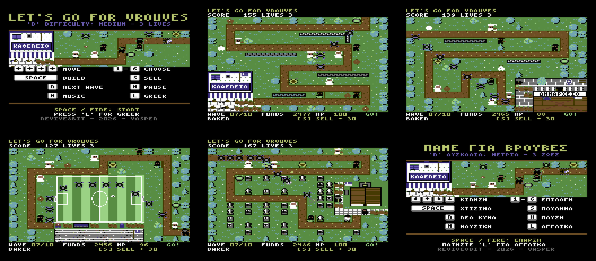

# LET'S GO FOR VROUVES / ΠΑΜΕ ΓΙΑ ΒΡΟΥΒΕΣ — Commodore 64

A top-down tower defence game for the **Commodore 64** (PAL), written in **6510 assembly**. It is the
C64 version of the [Amstrad CPC game](../VrouvesCPC): the same seven stages, waves, defenders, invaders,
rules, score, texts (English and Greek), graphics and music, rebuilt for the C64's hardware.

Armed with EU Directive 8647/2026, Frankenstein & Moreau CO. send bio-drones, compliance squads and
weed-destroying tanks to wipe out the wild, "copyrighted" *vrouves* of Crete. In Zoniana, the villagers
have to protect the Kafenio and its sacks of bitter greens. The rebel corporate drone **Psssst** has
defected to their side.

**Player's manual:** [English](docs/MANUAL.md) · [Ελληνικά](docs/MANUAL_GR.md)



## Running

```bash
make            # build/vrouves.d64 (disk) and build/vrouves.tap (tape)
make run        # x64sc with the disk autostarted (make run-tape: the tape)
```

On a C64 (or any emulator) with the disk in drive 8:

```
LOAD"VROUVES",8
RUN
```

The loading picture (`assets/vrouves.jpeg`, with the title) shows while the game loads. The disk stays
in the drive: the high scores are read from it and saved on it (`VR-HISCORE`), and the ending's picture
is loaded from it after the last stage.

### On cassette

`build/vrouves.tap`: `LOAD` and `RUN` (or SHIFT+RUN/STOP). A small boot file loads at the
KERNAL's speed, then a turbo loader (`src/tape.asm`, the one of the C64 Sugar Byte) reads the
loading picture, shown at once, and the game under it, the border flickering with the bits
(about 3 minutes of tape in all). The ending follows on the tape: leave it in the deck, it is read
when the last stage is won, and after it the C64 starts again. The high scores are kept for as
long as the C64 is on. A red border: a block did not load; wind back a little and PLAY.

## Controls

| Key | Action |
| --- | --- |
| Cursor keys (up / left with SHIFT) / Q A O P / joystick (port 2 or 1) | Move the build cursor |
| 1 – 6 | Choose a defender |
| SPACE / RETURN / FIRE | Build on the cursor tile |
| S / DEL | Sell the defender under the cursor (half price back) |
| N | Call the next wave now (half the seconds left on the countdown are paid as a bonus) |
| H / RUN/STOP | Pause / continue (RUN/STOP while paused quits to the title) |
| L | Switch English / Greek at any time |
| M | Music on / off |

On the title screen, → (or joystick right) flips between the pages: a scene with the keys, the story,
the defenders, the invaders and the high scores. D picks the difficulty (the lives for the whole game:
Easy 4, Medium 3, Hard 2, Hardest none).

## The game

Everything about the rules is the CPC's, tick for tick (see its [README](../VrouvesCPC/README.md)):
six defenders that join the village stage by stage (Cretan, Psssst, Yiayia, Bride, Baker, Cauldron),
neighbours that hit harder or softer side by side, three invaders (bio-drones that fly over the walls,
armoured guards, tanks that dent cauldrons), ten waves a stage, the score, the lives, the high score
table, and the feast at the school when the last stage is won.

## On the C64

- **A multicolour bitmap over the whole screen**, 160 × 200: the CPC's Mode 0 pixel is as wide as the
  C64's multicolour one, so the CPC's playfield (20 × 14 tiles of 8 × 12), its HUD rows and its 3×6 font
  (a letter a 4 × 8 cell) are laid out the same. The CPC's 16 pens map to C64 colours
  (`tools/c64gfx.py`); the grass green is the background colour.
- **The playfield is composed at run time** (`src/compose.asm`), cell by cell: the tile under the
  cell (CPC pens, two a byte), the defender standing there, the flag. A cell shows the background and
  three colours of its own: the 32 pixels' colours are counted, the three most common kept, and the
  others shown as the nearest of the four. Building, selling, a sack gone, a dented cauldron, the
  waving flag and the banner going all draw just their cells again. `tools/c64gfx.py` does the same
  for the previews in `build/preview/`.
- **Hardware sprites for everything that moves**: the invaders (all their frames, mirrored for walking
  left), the effects and the cursor, through a **sprite multiplexer** (`src/mux.asm`, `src/irq.asm`).
  The objects are sorted by Y each frame and each goes to the sprite that has been free the longest;
  the raster interrupts move the sprites down the screen as their last object ends. The order is the
  same every frame, so in a crowd of more than eight on the same lines the same ones keep their
  sprites, and the rest are drawn into the bitmap instead, in the darkest and brightest colours of the
  cells under them: no flicker.
- **The shots** are too many for the sprites: they are drawn straight into the bitmap in the brightest
  colour of the cell they cross. The bytes under shots and drawn objects are kept and put back before
  the next pass (`src/shots.asm`).
- **The logic runs at 25 Hz** as on the CPC (a tick every two frames, at most two ticks per pass of
  the loop), so the pace is the same whatever the drawing takes; the sprites and the input run at up to
  50 Hz.
- **SID music**: the CPC's tune (D minor) arranged for the SID — lead, bass through the filter, drums
  and chords — and a calm title tune of the same melody, with the CPC's effects on voice 3
  (`music/*.txt`, compiled by `tools/mkmusic64.py`; the player is the one of the C64 Sugar Byte and
  Runner A.P.E.R).
- **The high scores and the ending through the KERNAL**: the game leaves the KERNAL's memory
  ($90-$3ff) alone, so it can bank it in to load and save. The ending (the Blender render
  `assets/ending_scene.png`) and the loading picture (`assets/vrouves.jpeg`) are dithered to the
  C64's colours, cell by cell.

## Building

Requirements: [64tass](https://sourceforge.net/projects/tass64/), VICE 3.9 (`x64sc`, `c1541`),
Python 3 with Pillow.

```bash
make            # build/vrouves.d64 and build/vrouves.tap
make data       # src/data/ from tools/ and music/ (and build/preview/*.png)
make pictures   # the loading picture and the ending again (slow)
make debug      # rich, at wave 9, every defender (-D DEBUG=9)
make test       # the headless tests (VICE binary monitor)
make shots      # docs/screenshots.png and the manual's pictures
make manuals    # the manuals as PDF (needs markdown and weasyprint)
```

The tests (`tests/`, VICE's binary monitor): `test_boot` (memory, VIC, the title's pages),
`test_compose` (every stage's playfield byte for byte against `tools/c64gfx.py`), `test_game`
(building, selling, the waves, the sacks, winning, losing, pausing, the pace in a heavy wave),
`test_sound`, `test_disk` (a true 1541: the boot, a high score saved and read back, the ending)
and `test_tape` (the cassette, to the ending).

`TASSDEFS="-D START_STAGE=n" make` starts at stage n.

## Layout

```
src/        6510 sources: main (memory map, start, the stages), irq (raster interrupts), mux (the
            sprite multiplexer), input, video (the bitmap), text (the font, the texts), compose (a
            playfield cell), shots, game (the rules), hud, title, hiscore, disk (KERNAL loads and
            saves, the ending), lz (unpacking), sound (the SID player), boot (the loading picture);
            the tape: tape (the turbo loader), tapeboot, tapegame (instead of disk)
tools/      world.py (the stages, their art and renderers, the waves: the CPC's), art.py (the
            sprites), font.py, texts.py (all text, English and Greek), c64gfx.py (colours, cells,
            sprites), mkdata64.py (all the data), mkmusic64.py, lz.py, mktap.py, c64palette.py,
            screenshots64.py; splash_blender.py, ending_blender.py, blender_toon.py (the
            pictures' Blender scenes)
music/      the SID tunes, instruments and effects
assets/     the loading picture and the ending, their Blender scenes (from the CPC version)
tests/      headless VICE tests
docs/       the player's manual, English and Greek
```

---

**REVIVE8BIT · 2026 · VASPER**
